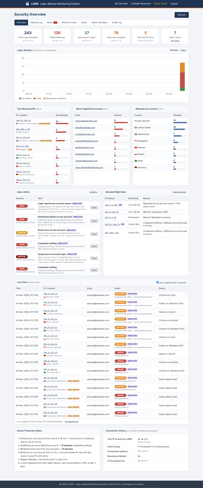

# LAMS - Login Attempt Monitoring System

A login and registration website that records every login attempt and protects accounts against
brute force, credential stuffing, distributed attacks and account takeover. Built with Java 21,
Spring Boot 4, Spring Security, Thymeleaf and MySQL.

Author: Sarth Sethi (24BCS1087), B.E. Computer Science and Engineering, Chandigarh University



## What it does

- Saves every attempt with IP, location, internet provider, browser/device, result and reason.
- Five detection rules:
  1. 5 wrong passwords for one account from one IP in 10 minutes lock that account for that IP only (15 min)
  2. 4 different accounts failing from one IP block the IP (credential stuffing)
  3. 10 failures from one IP block the IP
  4. 8 failures for one account from 3+ IPs lock the account for IPs its owner never used
  5. repeat blocks get longer: 15 min, 1 h, 24 h
- Blocked or locked requests are refused before the password is checked.
- Successful logins are risk-checked (after failures, new country, new device, VPN, script).
- The login page shows the real attempt counter and a countdown, read from the database.
- Users: login history, active sessions, sign out other devices, "This wasn't me", change password,
  breached-password check.
- Admin: overview with charts and live feed, attempt log with CSV, IP details, manual block/ban,
  trusted IPs, alerts, users, audit log and an attack simulator.
- Finds the real visitor IP behind Cloudflare on Render.

## Run it

```bash
cp .env.example .env              # fill in DB_PASSWORD, ADMIN_EMAIL, ADMIN_PASSWORD
./scripts/setup-local-mysql.sh    # creates the database user (or: docker compose up -d)
./mvnw spring-boot:run            # open http://localhost:<PORT>
./mvnw test                       # 106 automated tests
```

## Documents

| File | Contents |
|---|---|
| [docs/PROJECT_GUIDE.md](docs/PROJECT_GUIDE.md) | how everything works, with the key code |
| [docs/DEMO_WORKFLOW.md](docs/DEMO_WORKFLOW.md) | step-by-step demonstration of every feature |
| [docs/VIVA_QUESTIONS.md](docs/VIVA_QUESTIONS.md) | viva questions and answers |
| [docs/SETUP_AND_DEPLOYMENT.md](docs/SETUP_AND_DEPLOYMENT.md) | local setup, Render + Aiven deployment, troubleshooting |
| [docs/report/](docs/report/) | final project report, 107 pages (Word and PDF) |
| [docs/diagrams/](docs/diagrams/) | UML, ER, DFD and deployment diagrams |
| [docs/screenshots/](docs/screenshots/) | screenshots of every page |
| [docs/schema.sql](docs/schema.sql) | database schema |
